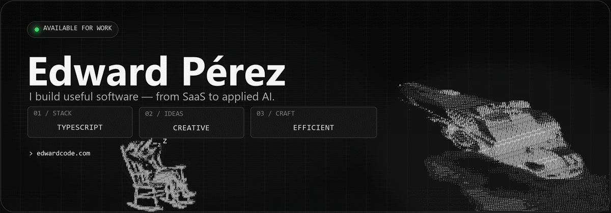

  <a href="https://edwardcode.com">edwardcode.com</a> ·
  <a href="https://www.linkedin.com/in/edwardperxz/">LinkedIn</a> ·
  <a href="mailto:edwardpereztapia@gmail.com">Email</a> ·
  <a href="https://wa.me/+50769882300">WhatsApp</a>

One ASCII shot at a time, FULL-STACK, AI, and UX shatter into new words as a detailed stickman walks right and points to edwardcode.com, against a monochrome background with a green active-status light.

### Thoughtful software. Ideas in motion.

I’m Edward, a software developer from Panamá. I turn complex ideas into useful products—from SaaS and real-time systems to applied AI. I care about thoughtful UX, solid engineering, and the details that make software feel alive.

`React` · `Next.js` · `TypeScript` · `Claude API` · `MCP`

### Built to make an impact

**[Xservicios](https://github.com/edwardperxz/xservicios)** — Led a four-person team in building a bilingual transport-management platform: **11 integrated modules**, **68 requirements**.

[Live demo](https://edwardcode.com/#projects) · [More projects](https://edwardcode.com/#projects): JobMatcher Pro · Alegator · BusNow

**Top 15 of 129** at the Copa Airlines Hackathon 2025 · Anthropic-certified in Claude API and MCP.

---

**Have an idea ready to grow?** [Let’s talk](mailto:edwardpereztapia@gmail.com) · [Explore my work](https://edwardcode.com)
