<a href="https://edwardcode.com">
  
</a>

<p align="center">
  <a href="https://edwardcode.com"></a>
  <a href="https://www.linkedin.com/in/edwardperxz/"></a>
  <a href="mailto:edwardpereztapia@gmail.com"></a>
  <a href="https://wa.me/+50769882300"></a>
</p>

<br>

<!-- ═══════════════════════════════ 3D LAB ═══════════════════════════════ -->
<h2> &nbsp;The Lab</h2>

**This bus is live 3D. Drag it, rotate it, zoom in.**
Then go drive the real one: my portfolio has a mode where you explore my work from behind the wheel.

<!-- BUS:START -->
```stl
solid edward_bus
  facet normal 0.0000 0.0000 -1.0000
    outer loop
      vertex 0.0000 0.0000 1.0000
      vertex 0.0000 4.0000 1.0000
      vertex 12.0000 4.0000 1.0000
    endloop
  endfacet
  facet normal 0.0000 0.0000 -1.0000
    outer loop
      vertex 0.0000 0.0000 1.0000
      vertex 12.0000 4.0000 1.0000
      vertex 12.0000 0.0000 1.0000
    endloop
  endfacet
  facet normal 0.0000 0.0000 1.0000
    outer loop
      vertex 0.0000 0.0000 5.0000
      vertex 12.0000 0.0000 5.0000
      vertex 12.0000 4.0000 5.0000
    endloop
  endfacet
  facet normal 0.0000 0.0000 1.0000
    outer loop
      vertex 0.0000 0.0000 5.0000
      vertex 12.0000 4.0000 5.0000
      vertex 0.0000 4.0000 5.0000
    endloop
  endfacet
  facet normal 0.0000 -1.0000 0.0000
    outer loop
      vertex 0.0000 0.0000 1.0000
      vertex 12.0000 0.0000 1.0000
      vertex 12.0000 0.0000 5.0000
    endloop
  endfacet
  facet normal 0.0000 -1.0000 0.0000
    outer loop
      vertex 0.0000 0.0000 1.0000
      vertex 12.0000 0.0000 5.0000
      vertex 0.0000 0.0000 5.0000
    endloop
  endfacet
  facet normal 0.0000 1.0000 0.0000
    outer loop
      vertex 12.0000 4.0000 1.0000
      vertex 0.0000 4.0000 1.0000
      vertex 0.0000 4.0000 5.0000
    endloop
  endfacet
  facet normal 0.0000 1.0000 0.0000
    outer loop
      vertex 12.0000 4.0000 1.0000
      vertex 0.0000 4.0000 5.0000
      vertex 12.0000 4.0000 5.0000
    endloop
  endfacet
  facet normal 1.0000 0.0000 0.0000
    outer loop
      vertex 12.0000 0.0000 1.0000
      vertex 12.0000 4.0000 1.0000
      vertex 12.0000 4.0000 5.0000
    endloop
  endfacet
  facet normal 1.0000 0.0000 0.0000
    outer loop
      vertex 12.0000 0.0000 1.0000
      vertex 12.0000 4.0000 5.0000
      vertex 12.0000 0.0000 5.0000
    endloop
  endfacet
  facet normal -1.0000 0.0000 0.0000
    outer loop
      vertex 0.0000 4.0000 1.0000
      vertex 0.0000 0.0000 1.0000
      vertex 0.0000 0.0000 5.0000
    endloop
  endfacet
  facet normal -1.0000 0.0000 0.0000
    outer loop
      vertex 0.0000 4.0000 1.0000
      vertex 0.0000 0.0000 5.0000
      vertex 0.0000 4.0000 5.0000
    endloop
  endfacet
  facet normal 0.0000 0.0000 -1.0000
    outer loop
      vertex 0.8000 -0.0800 3.1000
      vertex 0.8000 4.0800 3.1000
      vertex 11.2000 4.0800 3.1000
    endloop
  endfacet
  facet normal 0.0000 0.0000 -1.0000
    outer loop
      vertex 0.8000 -0.0800 3.1000
      vertex 11.2000 4.0800 3.1000
      vertex 11.2000 -0.0800 3.1000
    endloop
  endfacet
  facet normal 0.0000 0.0000 1.0000
    outer loop
      vertex 0.8000 -0.0800 4.4000
      vertex 11.2000 -0.0800 4.4000
      vertex 11.2000 4.0800 4.4000
    endloop
  endfacet
  facet normal 0.0000 0.0000 1.0000
    outer loop
      vertex 0.8000 -0.0800 4.4000
      vertex 11.2000 4.0800 4.4000
      vertex 0.8000 4.0800 4.4000
    endloop
  endfacet
  facet normal 0.0000 -1.0000 0.0000
    outer loop
      vertex 0.8000 -0.0800 3.1000
      vertex 11.2000 -0.0800 3.1000
      vertex 11.2000 -0.0800 4.4000
    endloop
  endfacet
  facet normal 0.0000 -1.0000 0.0000
    outer loop
      vertex 0.8000 -0.0800 3.1000
      vertex 11.2000 -0.0800 4.4000
      vertex 0.8000 -0.0800 4.4000
    endloop
  endfacet
  facet normal 0.0000 1.0000 0.0000
    outer loop
      vertex 11.2000 4.0800 3.1000
      vertex 0.8000 4.0800 3.1000
      vertex 0.8000 4.0800 4.4000
    endloop
  endfacet
  facet normal 0.0000 1.0000 -0.0000
    outer loop
      vertex 11.2000 4.0800 3.1000
      vertex 0.8000 4.0800 4.4000
      vertex 11.2000 4.0800 4.4000
    endloop
  endfacet
  facet normal 1.0000 0.0000 0.0000
    outer loop
      vertex 11.2000 -0.0800 3.1000
      vertex 11.2000 4.0800 3.1000
      vertex 11.2000 4.0800 4.4000
    endloop
  endfacet
  facet normal 1.0000 0.0000 0.0000
    outer loop
      vertex 11.2000 -0.0800 3.1000
      vertex 11.2000 4.0800 4.4000
      vertex 11.2000 -0.0800 4.4000
    endloop
  endfacet
  facet normal -1.0000 0.0000 0.0000
    outer loop
      vertex 0.8000 4.0800 3.1000
      vertex 0.8000 -0.0800 3.1000
      vertex 0.8000 -0.0800 4.4000
    endloop
  endfacet
  facet normal -1.0000 0.0000 0.0000
    outer loop
      vertex 0.8000 4.0800 3.1000
      vertex 0.8000 -0.0800 4.4000
      vertex 0.8000 4.0800 4.4000
    endloop
  endfacet
  facet normal 0.0000 0.0000 -1.0000
    outer loop
      vertex 11.9500 0.4000 2.6000
      vertex 11.9500 3.6000 2.6000
      vertex 12.1000 3.6000 2.6000
    endloop
  endfacet
  facet normal 0.0000 0.0000 -1.0000
    outer loop
      vertex 11.9500 0.4000 2.6000
      vertex 12.1000 3.6000 2.6000
      vertex 12.1000 0.4000 2.6000
    endloop
  endfacet
  facet normal 0.0000 0.0000 1.0000
    outer loop
      vertex 11.9500 0.4000 4.6000
      vertex 12.1000 0.4000 4.6000
      vertex 12.1000 3.6000 4.6000
    endloop
  endfacet
  facet normal 0.0000 0.0000 1.0000
    outer loop
      vertex 11.9500 0.4000 4.6000
      vertex 12.1000 3.6000 4.6000
      vertex 11.9500 3.6000 4.6000
    endloop
  endfacet
  facet normal 0.0000 -1.0000 0.0000
    outer loop
      vertex 11.9500 0.4000 2.6000
      vertex 12.1000 0.4000 2.6000
      vertex 12.1000 0.4000 4.6000
    endloop
  endfacet
  facet normal 0.0000 -1.0000 0.0000
    outer loop
      vertex 11.9500 0.4000 2.6000
      vertex 12.1000 0.4000 4.6000
      vertex 11.9500 0.4000 4.6000
    endloop
  endfacet
  facet normal 0.0000 1.0000 0.0000
    outer loop
      vertex 12.1000 3.6000 2.6000
      vertex 11.9500 3.6000 2.6000
      vertex 11.9500 3.6000 4.6000
    endloop
  endfacet
  facet normal 0.0000 1.0000 -0.0000
    outer loop
      vertex 12.1000 3.6000 2.6000
      vertex 11.9500 3.6000 4.6000
      vertex 12.1000 3.6000 4.6000
    endloop
  endfacet
  facet normal 1.0000 0.0000 0.0000
    outer loop
      vertex 12.1000 0.4000 2.6000
      vertex 12.1000 3.6000 2.6000
      vertex 12.1000 3.6000 4.6000
    endloop
  endfacet
  facet normal 1.0000 0.0000 0.0000
    outer loop
      vertex 12.1000 0.4000 2.6000
      vertex 12.1000 3.6000 4.6000
      vertex 12.1000 0.4000 4.6000
    endloop
  endfacet
  facet normal -1.0000 0.0000 0.0000
    outer loop
      vertex 11.9500 3.6000 2.6000
      vertex 11.9500 0.4000 2.6000
      vertex 11.9500 0.4000 4.6000
    endloop
  endfacet
  facet normal -1.0000 0.0000 0.0000
    outer loop
      vertex 11.9500 3.6000 2.6000
      vertex 11.9500 0.4000 4.6000
      vertex 11.9500 3.6000 4.6000
    endloop
  endfacet
  facet normal 0.0000 0.0000 -1.0000
    outer loop
      vertex 4.0000 1.0000 5.0000
      vertex 4.0000 3.0000 5.0000
      vertex 8.0000 3.0000 5.0000
    endloop
  endfacet
  facet normal 0.0000 0.0000 -1.0000
    outer loop
      vertex 4.0000 1.0000 5.0000
      vertex 8.0000 3.0000 5.0000
      vertex 8.0000 1.0000 5.0000
    endloop
  endfacet
  facet normal 0.0000 0.0000 1.0000
    outer loop
      vertex 4.0000 1.0000 5.5000
      vertex 8.0000 1.0000 5.5000
      vertex 8.0000 3.0000 5.5000
    endloop
  endfacet
  facet normal 0.0000 0.0000 1.0000
    outer loop
      vertex 4.0000 1.0000 5.5000
      vertex 8.0000 3.0000 5.5000
      vertex 4.0000 3.0000 5.5000
    endloop
  endfacet
  facet normal 0.0000 -1.0000 0.0000
    outer loop
      vertex 4.0000 1.0000 5.0000
      vertex 8.0000 1.0000 5.0000
      vertex 8.0000 1.0000 5.5000
    endloop
  endfacet
  facet normal 0.0000 -1.0000 0.0000
    outer loop
      vertex 4.0000 1.0000 5.0000
      vertex 8.0000 1.0000 5.5000
      vertex 4.0000 1.0000 5.5000
    endloop
  endfacet
  facet normal 0.0000 1.0000 0.0000
    outer loop
      vertex 8.0000 3.0000 5.0000
      vertex 4.0000 3.0000 5.0000
      vertex 4.0000 3.0000 5.5000
    endloop
  endfacet
  facet normal 0.0000 1.0000 0.0000
    outer loop
      vertex 8.0000 3.0000 5.0000
      vertex 4.0000 3.0000 5.5000
      vertex 8.0000 3.0000 5.5000
    endloop
  endfacet
  facet normal 1.0000 0.0000 0.0000
    outer loop
      vertex 8.0000 1.0000 5.0000
      vertex 8.0000 3.0000 5.0000
      vertex 8.0000 3.0000 5.5000
    endloop
  endfacet
  facet normal 1.0000 0.0000 0.0000
    outer loop
      vertex 8.0000 1.0000 5.0000
      vertex 8.0000 3.0000 5.5000
      vertex 8.0000 1.0000 5.5000
    endloop
  endfacet
  facet normal -1.0000 0.0000 0.0000
    outer loop
      vertex 4.0000 3.0000 5.0000
      vertex 4.0000 1.0000 5.0000
      vertex 4.0000 1.0000 5.5000
    endloop
  endfacet
  facet normal -1.0000 0.0000 0.0000
    outer loop
      vertex 4.0000 3.0000 5.0000
      vertex 4.0000 1.0000 5.5000
      vertex 4.0000 3.0000 5.5000
    endloop
  endfacet
  facet normal 0.0000 0.0000 -1.0000
    outer loop
      vertex -0.2500 0.2000 1.0000
      vertex -0.2500 3.8000 1.0000
      vertex 12.2500 3.8000 1.0000
    endloop
  endfacet
  facet normal 0.0000 0.0000 -1.0000
    outer loop
      vertex -0.2500 0.2000 1.0000
      vertex 12.2500 3.8000 1.0000
      vertex 12.2500 0.2000 1.0000
    endloop
  endfacet
  facet normal 0.0000 0.0000 1.0000
    outer loop
      vertex -0.2500 0.2000 1.5000
      vertex 12.2500 0.2000 1.5000
      vertex 12.2500 3.8000 1.5000
    endloop
  endfacet
  facet normal 0.0000 0.0000 1.0000
    outer loop
      vertex -0.2500 0.2000 1.5000
      vertex 12.2500 3.8000 1.5000
      vertex -0.2500 3.8000 1.5000
    endloop
  endfacet
  facet normal 0.0000 -1.0000 0.0000
    outer loop
      vertex -0.2500 0.2000 1.0000
      vertex 12.2500 0.2000 1.0000
      vertex 12.2500 0.2000 1.5000
    endloop
  endfacet
  facet normal 0.0000 -1.0000 0.0000
    outer loop
      vertex -0.2500 0.2000 1.0000
      vertex 12.2500 0.2000 1.5000
      vertex -0.2500 0.2000 1.5000
    endloop
  endfacet
  facet normal 0.0000 1.0000 0.0000
    outer loop
      vertex 12.2500 3.8000 1.0000
      vertex -0.2500 3.8000 1.0000
      vertex -0.2500 3.8000 1.5000
    endloop
  endfacet
  facet normal 0.0000 1.0000 -0.0000
    outer loop
      vertex 12.2500 3.8000 1.0000
      vertex -0.2500 3.8000 1.5000
      vertex 12.2500 3.8000 1.5000
    endloop
  endfacet
  facet normal 1.0000 0.0000 0.0000
    outer loop
      vertex 12.2500 0.2000 1.0000
      vertex 12.2500 3.8000 1.0000
      vertex 12.2500 3.8000 1.5000
    endloop
  endfacet
  facet normal 1.0000 0.0000 0.0000
    outer loop
      vertex 12.2500 0.2000 1.0000
      vertex 12.2500 3.8000 1.5000
      vertex 12.2500 0.2000 1.5000
    endloop
  endfacet
  facet normal -1.0000 0.0000 0.0000
    outer loop
      vertex -0.2500 3.8000 1.0000
      vertex -0.2500 0.2000 1.0000
      vertex -0.2500 0.2000 1.5000
    endloop
  endfacet
  facet normal -1.0000 0.0000 0.0000
    outer loop
      vertex -0.2500 3.8000 1.0000
      vertex -0.2500 0.2000 1.5000
      vertex -0.2500 3.8000 1.5000
    endloop
  endfacet
  facet normal 0.9808 -0.0000 0.1951
    outer loop
      vertex 3.5000 -0.3500 1.0000
      vertex 3.4239 0.6500 1.3827
      vertex 3.4239 -0.3500 1.3827
    endloop
  endfacet
  facet normal 0.9808 -0.0000 0.1951
    outer loop
      vertex 3.5000 -0.3500 1.0000
      vertex 3.5000 0.6500 1.0000
      vertex 3.4239 0.6500 1.3827
    endloop
  endfacet
  facet normal -0.0000 -1.0000 -0.0000
    outer loop
      vertex 2.5000 -0.3500 1.0000
      vertex 3.5000 -0.3500 1.0000
      vertex 3.4239 -0.3500 1.3827
    endloop
  endfacet
  facet normal -0.0000 1.0000 -0.0000
    outer loop
      vertex 2.5000 0.6500 1.0000
      vertex 3.4239 0.6500 1.3827
      vertex 3.5000 0.6500 1.0000
    endloop
  endfacet
  facet normal 0.8315 -0.0000 0.5556
    outer loop
      vertex 3.4239 -0.3500 1.3827
      vertex 3.2071 0.6500 1.7071
      vertex 3.2071 -0.3500 1.7071
    endloop
  endfacet
  facet normal 0.8315 -0.0000 0.5556
    outer loop
      vertex 3.4239 -0.3500 1.3827
      vertex 3.4239 0.6500 1.3827
      vertex 3.2071 0.6500 1.7071
    endloop
  endfacet
  facet normal -0.0000 -1.0000 -0.0000
    outer loop
      vertex 2.5000 -0.3500 1.0000
      vertex 3.4239 -0.3500 1.3827
      vertex 3.2071 -0.3500 1.7071
    endloop
  endfacet
  facet normal -0.0000 1.0000 -0.0000
    outer loop
      vertex 2.5000 0.6500 1.0000
      vertex 3.2071 0.6500 1.7071
      vertex 3.4239 0.6500 1.3827
    endloop
  endfacet
  facet normal 0.5556 -0.0000 0.8315
    outer loop
      vertex 3.2071 -0.3500 1.7071
      vertex 2.8827 0.6500 1.9239
      vertex 2.8827 -0.3500 1.9239
    endloop
  endfacet
  facet normal 0.5556 -0.0000 0.8315
    outer loop
      vertex 3.2071 -0.3500 1.7071
      vertex 3.2071 0.6500 1.7071
      vertex 2.8827 0.6500 1.9239
    endloop
  endfacet
  facet normal -0.0000 -1.0000 -0.0000
    outer loop
      vertex 2.5000 -0.3500 1.0000
      vertex 3.2071 -0.3500 1.7071
      vertex 2.8827 -0.3500 1.9239
    endloop
  endfacet
  facet normal -0.0000 1.0000 -0.0000
    outer loop
      vertex 2.5000 0.6500 1.0000
      vertex 2.8827 0.6500 1.9239
      vertex 3.2071 0.6500 1.7071
    endloop
  endfacet
  facet normal 0.1951 -0.0000 0.9808
    outer loop
      vertex 2.8827 -0.3500 1.9239
      vertex 2.5000 0.6500 2.0000
      vertex 2.5000 -0.3500 2.0000
    endloop
  endfacet
  facet normal 0.1951 -0.0000 0.9808
    outer loop
      vertex 2.8827 -0.3500 1.9239
      vertex 2.8827 0.6500 1.9239
      vertex 2.5000 0.6500 2.0000
    endloop
  endfacet
  facet normal -0.0000 -1.0000 -0.0000
    outer loop
      vertex 2.5000 -0.3500 1.0000
      vertex 2.8827 -0.3500 1.9239
      vertex 2.5000 -0.3500 2.0000
    endloop
  endfacet
  facet normal -0.0000 1.0000 -0.0000
    outer loop
      vertex 2.5000 0.6500 1.0000
      vertex 2.5000 0.6500 2.0000
      vertex 2.8827 0.6500 1.9239
    endloop
  endfacet
  facet normal -0.1951 -0.0000 0.9808
    outer loop
      vertex 2.5000 -0.3500 2.0000
      vertex 2.1173 0.6500 1.9239
      vertex 2.1173 -0.3500 1.9239
    endloop
  endfacet
  facet normal -0.1951 -0.0000 0.9808
    outer loop
      vertex 2.5000 -0.3500 2.0000
      vertex 2.5000 0.6500 2.0000
      vertex 2.1173 0.6500 1.9239
    endloop
  endfacet
  facet normal -0.0000 -1.0000 0.0000
    outer loop
      vertex 2.5000 -0.3500 1.0000
      vertex 2.5000 -0.3500 2.0000
      vertex 2.1173 -0.3500 1.9239
    endloop
  endfacet
  facet normal -0.0000 1.0000 -0.0000
    outer loop
      vertex 2.5000 0.6500 1.0000
      vertex 2.1173 0.6500 1.9239
      vertex 2.5000 0.6500 2.0000
    endloop
  endfacet
  facet normal -0.5556 -0.0000 0.8315
    outer loop
      vertex 2.1173 -0.3500 1.9239
      vertex 1.7929 0.6500 1.7071
      vertex 1.7929 -0.3500 1.7071
    endloop
  endfacet
  facet normal -0.5556 -0.0000 0.8315
    outer loop
      vertex 2.1173 -0.3500 1.9239
      vertex 2.1173 0.6500 1.9239
      vertex 1.7929 0.6500 1.7071
    endloop
  endfacet
  facet normal -0.0000 -1.0000 -0.0000
    outer loop
      vertex 2.5000 -0.3500 1.0000
      vertex 2.1173 -0.3500 1.9239
      vertex 1.7929 -0.3500 1.7071
    endloop
  endfacet
  facet normal -0.0000 1.0000 -0.0000
    outer loop
      vertex 2.5000 0.6500 1.0000
      vertex 1.7929 0.6500 1.7071
      vertex 2.1173 0.6500 1.9239
    endloop
  endfacet
  facet normal -0.8315 -0.0000 0.5556
    outer loop
      vertex 1.7929 -0.3500 1.7071
      vertex 1.5761 0.6500 1.3827
      vertex 1.5761 -0.3500 1.3827
    endloop
  endfacet
  facet normal -0.8315 -0.0000 0.5556
    outer loop
      vertex 1.7929 -0.3500 1.7071
      vertex 1.7929 0.6500 1.7071
      vertex 1.5761 0.6500 1.3827
    endloop
  endfacet
  facet normal -0.0000 -1.0000 -0.0000
    outer loop
      vertex 2.5000 -0.3500 1.0000
      vertex 1.7929 -0.3500 1.7071
      vertex 1.5761 -0.3500 1.3827
    endloop
  endfacet
  facet normal -0.0000 1.0000 -0.0000
    outer loop
      vertex 2.5000 0.6500 1.0000
      vertex 1.5761 0.6500 1.3827
      vertex 1.7929 0.6500 1.7071
    endloop
  endfacet
  facet normal -0.9808 -0.0000 0.1951
    outer loop
      vertex 1.5761 -0.3500 1.3827
      vertex 1.5000 0.6500 1.0000
      vertex 1.5000 -0.3500 1.0000
    endloop
  endfacet
  facet normal -0.9808 -0.0000 0.1951
    outer loop
      vertex 1.5761 -0.3500 1.3827
      vertex 1.5761 0.6500 1.3827
      vertex 1.5000 0.6500 1.0000
    endloop
  endfacet
  facet normal -0.0000 -1.0000 -0.0000
    outer loop
      vertex 2.5000 -0.3500 1.0000
      vertex 1.5761 -0.3500 1.3827
      vertex 1.5000 -0.3500 1.0000
    endloop
  endfacet
  facet normal -0.0000 1.0000 -0.0000
    outer loop
      vertex 2.5000 0.6500 1.0000
      vertex 1.5000 0.6500 1.0000
      vertex 1.5761 0.6500 1.3827
    endloop
  endfacet
  facet normal -0.9808 -0.0000 -0.1951
    outer loop
      vertex 1.5000 -0.3500 1.0000
      vertex 1.5761 0.6500 0.6173
      vertex 1.5761 -0.3500 0.6173
    endloop
  endfacet
  facet normal -0.9808 0.0000 -0.1951
    outer loop
      vertex 1.5000 -0.3500 1.0000
      vertex 1.5000 0.6500 1.0000
      vertex 1.5761 0.6500 0.6173
    endloop
  endfacet
  facet normal -0.0000 -1.0000 -0.0000
    outer loop
      vertex 2.5000 -0.3500 1.0000
      vertex 1.5000 -0.3500 1.0000
      vertex 1.5761 -0.3500 0.6173
    endloop
  endfacet
  facet normal 0.0000 1.0000 -0.0000
    outer loop
      vertex 2.5000 0.6500 1.0000
      vertex 1.5761 0.6500 0.6173
      vertex 1.5000 0.6500 1.0000
    endloop
  endfacet
  facet normal -0.8315 -0.0000 -0.5556
    outer loop
      vertex 1.5761 -0.3500 0.6173
      vertex 1.7929 0.6500 0.2929
      vertex 1.7929 -0.3500 0.2929
    endloop
  endfacet
  facet normal -0.8315 0.0000 -0.5556
    outer loop
      vertex 1.5761 -0.3500 0.6173
      vertex 1.5761 0.6500 0.6173
      vertex 1.7929 0.6500 0.2929
    endloop
  endfacet
  facet normal -0.0000 -1.0000 -0.0000
    outer loop
      vertex 2.5000 -0.3500 1.0000
      vertex 1.5761 -0.3500 0.6173
      vertex 1.7929 -0.3500 0.2929
    endloop
  endfacet
  facet normal -0.0000 1.0000 -0.0000
    outer loop
      vertex 2.5000 0.6500 1.0000
      vertex 1.7929 0.6500 0.2929
      vertex 1.5761 0.6500 0.6173
    endloop
  endfacet
  facet normal -0.5556 -0.0000 -0.8315
    outer loop
      vertex 1.7929 -0.3500 0.2929
      vertex 2.1173 0.6500 0.0761
      vertex 2.1173 -0.3500 0.0761
    endloop
  endfacet
  facet normal -0.5556 0.0000 -0.8315
    outer loop
      vertex 1.7929 -0.3500 0.2929
      vertex 1.7929 0.6500 0.2929
      vertex 2.1173 0.6500 0.0761
    endloop
  endfacet
  facet normal -0.0000 -1.0000 -0.0000
    outer loop
      vertex 2.5000 -0.3500 1.0000
      vertex 1.7929 -0.3500 0.2929
      vertex 2.1173 -0.3500 0.0761
    endloop
  endfacet
  facet normal -0.0000 1.0000 -0.0000
    outer loop
      vertex 2.5000 0.6500 1.0000
      vertex 2.1173 0.6500 0.0761
      vertex 1.7929 0.6500 0.2929
    endloop
  endfacet
  facet normal -0.1951 -0.0000 -0.9808
    outer loop
      vertex 2.1173 -0.3500 0.0761
      vertex 2.5000 0.6500 0.0000
      vertex 2.5000 -0.3500 0.0000
    endloop
  endfacet
  facet normal -0.1951 0.0000 -0.9808
    outer loop
      vertex 2.1173 -0.3500 0.0761
      vertex 2.1173 0.6500 0.0761
      vertex 2.5000 0.6500 0.0000
    endloop
  endfacet
  facet normal -0.0000 -1.0000 -0.0000
    outer loop
      vertex 2.5000 -0.3500 1.0000
      vertex 2.1173 -0.3500 0.0761
      vertex 2.5000 -0.3500 0.0000
    endloop
  endfacet
  facet normal -0.0000 1.0000 0.0000
    outer loop
      vertex 2.5000 0.6500 1.0000
      vertex 2.5000 0.6500 0.0000
      vertex 2.1173 0.6500 0.0761
    endloop
  endfacet
  facet normal 0.1951 -0.0000 -0.9808
    outer loop
      vertex 2.5000 -0.3500 0.0000
      vertex 2.8827 0.6500 0.0761
      vertex 2.8827 -0.3500 0.0761
    endloop
  endfacet
  facet normal 0.1951 -0.0000 -0.9808
    outer loop
      vertex 2.5000 -0.3500 0.0000
      vertex 2.5000 0.6500 0.0000
      vertex 2.8827 0.6500 0.0761
    endloop
  endfacet
  facet normal -0.0000 -1.0000 -0.0000
    outer loop
      vertex 2.5000 -0.3500 1.0000
      vertex 2.5000 -0.3500 0.0000
      vertex 2.8827 -0.3500 0.0761
    endloop
  endfacet
  facet normal -0.0000 1.0000 -0.0000
    outer loop
      vertex 2.5000 0.6500 1.0000
      vertex 2.8827 0.6500 0.0761
      vertex 2.5000 0.6500 0.0000
    endloop
  endfacet
  facet normal 0.5556 -0.0000 -0.8315
    outer loop
      vertex 2.8827 -0.3500 0.0761
      vertex 3.2071 0.6500 0.2929
      vertex 3.2071 -0.3500 0.2929
    endloop
  endfacet
  facet normal 0.5556 -0.0000 -0.8315
    outer loop
      vertex 2.8827 -0.3500 0.0761
      vertex 2.8827 0.6500 0.0761
      vertex 3.2071 0.6500 0.2929
    endloop
  endfacet
  facet normal -0.0000 -1.0000 -0.0000
    outer loop
      vertex 2.5000 -0.3500 1.0000
      vertex 2.8827 -0.3500 0.0761
      vertex 3.2071 -0.3500 0.2929
    endloop
  endfacet
  facet normal -0.0000 1.0000 -0.0000
    outer loop
      vertex 2.5000 0.6500 1.0000
      vertex 3.2071 0.6500 0.2929
      vertex 2.8827 0.6500 0.0761
    endloop
  endfacet
  facet normal 0.8315 -0.0000 -0.5556
    outer loop
      vertex 3.2071 -0.3500 0.2929
      vertex 3.4239 0.6500 0.6173
      vertex 3.4239 -0.3500 0.6173
    endloop
  endfacet
  facet normal 0.8315 -0.0000 -0.5556
    outer loop
      vertex 3.2071 -0.3500 0.2929
      vertex 3.2071 0.6500 0.2929
      vertex 3.4239 0.6500 0.6173
    endloop
  endfacet
  facet normal -0.0000 -1.0000 -0.0000
    outer loop
      vertex 2.5000 -0.3500 1.0000
      vertex 3.2071 -0.3500 0.2929
      vertex 3.4239 -0.3500 0.6173
    endloop
  endfacet
  facet normal -0.0000 1.0000 -0.0000
    outer loop
      vertex 2.5000 0.6500 1.0000
      vertex 3.4239 0.6500 0.6173
      vertex 3.2071 0.6500 0.2929
    endloop
  endfacet
  facet normal 0.9808 -0.0000 -0.1951
    outer loop
      vertex 3.4239 -0.3500 0.6173
      vertex 3.5000 0.6500 1.0000
      vertex 3.5000 -0.3500 1.0000
    endloop
  endfacet
  facet normal 0.9808 -0.0000 -0.1951
    outer loop
      vertex 3.4239 -0.3500 0.6173
      vertex 3.4239 0.6500 0.6173
      vertex 3.5000 0.6500 1.0000
    endloop
  endfacet
  facet normal 0.0000 -1.0000 -0.0000
    outer loop
      vertex 2.5000 -0.3500 1.0000
      vertex 3.4239 -0.3500 0.6173
      vertex 3.5000 -0.3500 1.0000
    endloop
  endfacet
  facet normal -0.0000 1.0000 -0.0000
    outer loop
      vertex 2.5000 0.6500 1.0000
      vertex 3.5000 0.6500 1.0000
      vertex 3.4239 0.6500 0.6173
    endloop
  endfacet
  facet normal 0.9808 -0.0000 0.1951
    outer loop
      vertex 3.5000 3.3500 1.0000
      vertex 3.4239 4.3500 1.3827
      vertex 3.4239 3.3500 1.3827
    endloop
  endfacet
  facet normal 0.9808 -0.0000 0.1951
    outer loop
      vertex 3.5000 3.3500 1.0000
      vertex 3.5000 4.3500 1.0000
      vertex 3.4239 4.3500 1.3827
    endloop
  endfacet
  facet normal -0.0000 -1.0000 -0.0000
    outer loop
      vertex 2.5000 3.3500 1.0000
      vertex 3.5000 3.3500 1.0000
      vertex 3.4239 3.3500 1.3827
    endloop
  endfacet
  facet normal -0.0000 1.0000 -0.0000
    outer loop
      vertex 2.5000 4.3500 1.0000
      vertex 3.4239 4.3500 1.3827
      vertex 3.5000 4.3500 1.0000
    endloop
  endfacet
  facet normal 0.8315 -0.0000 0.5556
    outer loop
      vertex 3.4239 3.3500 1.3827
      vertex 3.2071 4.3500 1.7071
      vertex 3.2071 3.3500 1.7071
    endloop
  endfacet
  facet normal 0.8315 -0.0000 0.5556
    outer loop
      vertex 3.4239 3.3500 1.3827
      vertex 3.4239 4.3500 1.3827
      vertex 3.2071 4.3500 1.7071
    endloop
  endfacet
  facet normal -0.0000 -1.0000 -0.0000
    outer loop
      vertex 2.5000 3.3500 1.0000
      vertex 3.4239 3.3500 1.3827
      vertex 3.2071 3.3500 1.7071
    endloop
  endfacet
  facet normal -0.0000 1.0000 -0.0000
    outer loop
      vertex 2.5000 4.3500 1.0000
      vertex 3.2071 4.3500 1.7071
      vertex 3.4239 4.3500 1.3827
    endloop
  endfacet
  facet normal 0.5556 -0.0000 0.8315
    outer loop
      vertex 3.2071 3.3500 1.7071
      vertex 2.8827 4.3500 1.9239
      vertex 2.8827 3.3500 1.9239
    endloop
  endfacet
  facet normal 0.5556 -0.0000 0.8315
    outer loop
      vertex 3.2071 3.3500 1.7071
      vertex 3.2071 4.3500 1.7071
      vertex 2.8827 4.3500 1.9239
    endloop
  endfacet
  facet normal -0.0000 -1.0000 -0.0000
    outer loop
      vertex 2.5000 3.3500 1.0000
      vertex 3.2071 3.3500 1.7071
      vertex 2.8827 3.3500 1.9239
    endloop
  endfacet
  facet normal -0.0000 1.0000 -0.0000
    outer loop
      vertex 2.5000 4.3500 1.0000
      vertex 2.8827 4.3500 1.9239
      vertex 3.2071 4.3500 1.7071
    endloop
  endfacet
  facet normal 0.1951 -0.0000 0.9808
    outer loop
      vertex 2.8827 3.3500 1.9239
      vertex 2.5000 4.3500 2.0000
      vertex 2.5000 3.3500 2.0000
    endloop
  endfacet
  facet normal 0.1951 -0.0000 0.9808
    outer loop
      vertex 2.8827 3.3500 1.9239
      vertex 2.8827 4.3500 1.9239
      vertex 2.5000 4.3500 2.0000
    endloop
  endfacet
  facet normal -0.0000 -1.0000 -0.0000
    outer loop
      vertex 2.5000 3.3500 1.0000
      vertex 2.8827 3.3500 1.9239
      vertex 2.5000 3.3500 2.0000
    endloop
  endfacet
  facet normal -0.0000 1.0000 -0.0000
    outer loop
      vertex 2.5000 4.3500 1.0000
      vertex 2.5000 4.3500 2.0000
      vertex 2.8827 4.3500 1.9239
    endloop
  endfacet
  facet normal -0.1951 -0.0000 0.9808
    outer loop
      vertex 2.5000 3.3500 2.0000
      vertex 2.1173 4.3500 1.9239
      vertex 2.1173 3.3500 1.9239
    endloop
  endfacet
  facet normal -0.1951 -0.0000 0.9808
    outer loop
      vertex 2.5000 3.3500 2.0000
      vertex 2.5000 4.3500 2.0000
      vertex 2.1173 4.3500 1.9239
    endloop
  endfacet
  facet normal -0.0000 -1.0000 0.0000
    outer loop
      vertex 2.5000 3.3500 1.0000
      vertex 2.5000 3.3500 2.0000
      vertex 2.1173 3.3500 1.9239
    endloop
  endfacet
  facet normal -0.0000 1.0000 -0.0000
    outer loop
      vertex 2.5000 4.3500 1.0000
      vertex 2.1173 4.3500 1.9239
      vertex 2.5000 4.3500 2.0000
    endloop
  endfacet
  facet normal -0.5556 -0.0000 0.8315
    outer loop
      vertex 2.1173 3.3500 1.9239
      vertex 1.7929 4.3500 1.7071
      vertex 1.7929 3.3500 1.7071
    endloop
  endfacet
  facet normal -0.5556 -0.0000 0.8315
    outer loop
      vertex 2.1173 3.3500 1.9239
      vertex 2.1173 4.3500 1.9239
      vertex 1.7929 4.3500 1.7071
    endloop
  endfacet
  facet normal -0.0000 -1.0000 -0.0000
    outer loop
      vertex 2.5000 3.3500 1.0000
      vertex 2.1173 3.3500 1.9239
      vertex 1.7929 3.3500 1.7071
    endloop
  endfacet
  facet normal -0.0000 1.0000 -0.0000
    outer loop
      vertex 2.5000 4.3500 1.0000
      vertex 1.7929 4.3500 1.7071
      vertex 2.1173 4.3500 1.9239
    endloop
  endfacet
  facet normal -0.8315 -0.0000 0.5556
    outer loop
      vertex 1.7929 3.3500 1.7071
      vertex 1.5761 4.3500 1.3827
      vertex 1.5761 3.3500 1.3827
    endloop
  endfacet
  facet normal -0.8315 -0.0000 0.5556
    outer loop
      vertex 1.7929 3.3500 1.7071
      vertex 1.7929 4.3500 1.7071
      vertex 1.5761 4.3500 1.3827
    endloop
  endfacet
  facet normal -0.0000 -1.0000 -0.0000
    outer loop
      vertex 2.5000 3.3500 1.0000
      vertex 1.7929 3.3500 1.7071
      vertex 1.5761 3.3500 1.3827
    endloop
  endfacet
  facet normal -0.0000 1.0000 -0.0000
    outer loop
      vertex 2.5000 4.3500 1.0000
      vertex 1.5761 4.3500 1.3827
      vertex 1.7929 4.3500 1.7071
    endloop
  endfacet
  facet normal -0.9808 -0.0000 0.1951
    outer loop
      vertex 1.5761 3.3500 1.3827
      vertex 1.5000 4.3500 1.0000
      vertex 1.5000 3.3500 1.0000
    endloop
  endfacet
  facet normal -0.9808 -0.0000 0.1951
    outer loop
      vertex 1.5761 3.3500 1.3827
      vertex 1.5761 4.3500 1.3827
      vertex 1.5000 4.3500 1.0000
    endloop
  endfacet
  facet normal -0.0000 -1.0000 -0.0000
    outer loop
      vertex 2.5000 3.3500 1.0000
      vertex 1.5761 3.3500 1.3827
      vertex 1.5000 3.3500 1.0000
    endloop
  endfacet
  facet normal -0.0000 1.0000 -0.0000
    outer loop
      vertex 2.5000 4.3500 1.0000
      vertex 1.5000 4.3500 1.0000
      vertex 1.5761 4.3500 1.3827
    endloop
  endfacet
  facet normal -0.9808 -0.0000 -0.1951
    outer loop
      vertex 1.5000 3.3500 1.0000
      vertex 1.5761 4.3500 0.6173
      vertex 1.5761 3.3500 0.6173
    endloop
  endfacet
  facet normal -0.9808 0.0000 -0.1951
    outer loop
      vertex 1.5000 3.3500 1.0000
      vertex 1.5000 4.3500 1.0000
      vertex 1.5761 4.3500 0.6173
    endloop
  endfacet
  facet normal -0.0000 -1.0000 -0.0000
    outer loop
      vertex 2.5000 3.3500 1.0000
      vertex 1.5000 3.3500 1.0000
      vertex 1.5761 3.3500 0.6173
    endloop
  endfacet
  facet normal 0.0000 1.0000 -0.0000
    outer loop
      vertex 2.5000 4.3500 1.0000
      vertex 1.5761 4.3500 0.6173
      vertex 1.5000 4.3500 1.0000
    endloop
  endfacet
  facet normal -0.8315 -0.0000 -0.5556
    outer loop
      vertex 1.5761 3.3500 0.6173
      vertex 1.7929 4.3500 0.2929
      vertex 1.7929 3.3500 0.2929
    endloop
  endfacet
  facet normal -0.8315 0.0000 -0.5556
    outer loop
      vertex 1.5761 3.3500 0.6173
      vertex 1.5761 4.3500 0.6173
      vertex 1.7929 4.3500 0.2929
    endloop
  endfacet
  facet normal -0.0000 -1.0000 -0.0000
    outer loop
      vertex 2.5000 3.3500 1.0000
      vertex 1.5761 3.3500 0.6173
      vertex 1.7929 3.3500 0.2929
    endloop
  endfacet
  facet normal -0.0000 1.0000 -0.0000
    outer loop
      vertex 2.5000 4.3500 1.0000
      vertex 1.7929 4.3500 0.2929
      vertex 1.5761 4.3500 0.6173
    endloop
  endfacet
  facet normal -0.5556 -0.0000 -0.8315
    outer loop
      vertex 1.7929 3.3500 0.2929
      vertex 2.1173 4.3500 0.0761
      vertex 2.1173 3.3500 0.0761
    endloop
  endfacet
  facet normal -0.5556 0.0000 -0.8315
    outer loop
      vertex 1.7929 3.3500 0.2929
      vertex 1.7929 4.3500 0.2929
      vertex 2.1173 4.3500 0.0761
    endloop
  endfacet
  facet normal -0.0000 -1.0000 -0.0000
    outer loop
      vertex 2.5000 3.3500 1.0000
      vertex 1.7929 3.3500 0.2929
      vertex 2.1173 3.3500 0.0761
    endloop
  endfacet
  facet normal -0.0000 1.0000 -0.0000
    outer loop
      vertex 2.5000 4.3500 1.0000
      vertex 2.1173 4.3500 0.0761
      vertex 1.7929 4.3500 0.2929
    endloop
  endfacet
  facet normal -0.1951 -0.0000 -0.9808
    outer loop
      vertex 2.1173 3.3500 0.0761
      vertex 2.5000 4.3500 0.0000
      vertex 2.5000 3.3500 0.0000
    endloop
  endfacet
  facet normal -0.1951 0.0000 -0.9808
    outer loop
      vertex 2.1173 3.3500 0.0761
      vertex 2.1173 4.3500 0.0761
      vertex 2.5000 4.3500 0.0000
    endloop
  endfacet
  facet normal -0.0000 -1.0000 -0.0000
    outer loop
      vertex 2.5000 3.3500 1.0000
      vertex 2.1173 3.3500 0.0761
      vertex 2.5000 3.3500 0.0000
    endloop
  endfacet
  facet normal -0.0000 1.0000 0.0000
    outer loop
      vertex 2.5000 4.3500 1.0000
      vertex 2.5000 4.3500 0.0000
      vertex 2.1173 4.3500 0.0761
    endloop
  endfacet
  facet normal 0.1951 -0.0000 -0.9808
    outer loop
      vertex 2.5000 3.3500 0.0000
      vertex 2.8827 4.3500 0.0761
      vertex 2.8827 3.3500 0.0761
    endloop
  endfacet
  facet normal 0.1951 -0.0000 -0.9808
    outer loop
      vertex 2.5000 3.3500 0.0000
      vertex 2.5000 4.3500 0.0000
      vertex 2.8827 4.3500 0.0761
    endloop
  endfacet
  facet normal -0.0000 -1.0000 -0.0000
    outer loop
      vertex 2.5000 3.3500 1.0000
      vertex 2.5000 3.3500 0.0000
      vertex 2.8827 3.3500 0.0761
    endloop
  endfacet
  facet normal -0.0000 1.0000 -0.0000
    outer loop
      vertex 2.5000 4.3500 1.0000
      vertex 2.8827 4.3500 0.0761
      vertex 2.5000 4.3500 0.0000
    endloop
  endfacet
  facet normal 0.5556 -0.0000 -0.8315
    outer loop
      vertex 2.8827 3.3500 0.0761
      vertex 3.2071 4.3500 0.2929
      vertex 3.2071 3.3500 0.2929
    endloop
  endfacet
  facet normal 0.5556 -0.0000 -0.8315
    outer loop
      vertex 2.8827 3.3500 0.0761
      vertex 2.8827 4.3500 0.0761
      vertex 3.2071 4.3500 0.2929
    endloop
  endfacet
  facet normal -0.0000 -1.0000 -0.0000
    outer loop
      vertex 2.5000 3.3500 1.0000
      vertex 2.8827 3.3500 0.0761
      vertex 3.2071 3.3500 0.2929
    endloop
  endfacet
  facet normal -0.0000 1.0000 -0.0000
    outer loop
      vertex 2.5000 4.3500 1.0000
      vertex 3.2071 4.3500 0.2929
      vertex 2.8827 4.3500 0.0761
    endloop
  endfacet
  facet normal 0.8315 -0.0000 -0.5556
    outer loop
      vertex 3.2071 3.3500 0.2929
      vertex 3.4239 4.3500 0.6173
      vertex 3.4239 3.3500 0.6173
    endloop
  endfacet
  facet normal 0.8315 -0.0000 -0.5556
    outer loop
      vertex 3.2071 3.3500 0.2929
      vertex 3.2071 4.3500 0.2929
      vertex 3.4239 4.3500 0.6173
    endloop
  endfacet
  facet normal -0.0000 -1.0000 -0.0000
    outer loop
      vertex 2.5000 3.3500 1.0000
      vertex 3.2071 3.3500 0.2929
      vertex 3.4239 3.3500 0.6173
    endloop
  endfacet
  facet normal -0.0000 1.0000 -0.0000
    outer loop
      vertex 2.5000 4.3500 1.0000
      vertex 3.4239 4.3500 0.6173
      vertex 3.2071 4.3500 0.2929
    endloop
  endfacet
  facet normal 0.9808 -0.0000 -0.1951
    outer loop
      vertex 3.4239 3.3500 0.6173
      vertex 3.5000 4.3500 1.0000
      vertex 3.5000 3.3500 1.0000
    endloop
  endfacet
  facet normal 0.9808 -0.0000 -0.1951
    outer loop
      vertex 3.4239 3.3500 0.6173
      vertex 3.4239 4.3500 0.6173
      vertex 3.5000 4.3500 1.0000
    endloop
  endfacet
  facet normal 0.0000 -1.0000 -0.0000
    outer loop
      vertex 2.5000 3.3500 1.0000
      vertex 3.4239 3.3500 0.6173
      vertex 3.5000 3.3500 1.0000
    endloop
  endfacet
  facet normal -0.0000 1.0000 -0.0000
    outer loop
      vertex 2.5000 4.3500 1.0000
      vertex 3.5000 4.3500 1.0000
      vertex 3.4239 4.3500 0.6173
    endloop
  endfacet
  facet normal 0.9808 -0.0000 0.1951
    outer loop
      vertex 10.5000 -0.3500 1.0000
      vertex 10.4239 0.6500 1.3827
      vertex 10.4239 -0.3500 1.3827
    endloop
  endfacet
  facet normal 0.9808 -0.0000 0.1951
    outer loop
      vertex 10.5000 -0.3500 1.0000
      vertex 10.5000 0.6500 1.0000
      vertex 10.4239 0.6500 1.3827
    endloop
  endfacet
  facet normal -0.0000 -1.0000 -0.0000
    outer loop
      vertex 9.5000 -0.3500 1.0000
      vertex 10.5000 -0.3500 1.0000
      vertex 10.4239 -0.3500 1.3827
    endloop
  endfacet
  facet normal -0.0000 1.0000 -0.0000
    outer loop
      vertex 9.5000 0.6500 1.0000
      vertex 10.4239 0.6500 1.3827
      vertex 10.5000 0.6500 1.0000
    endloop
  endfacet
  facet normal 0.8315 -0.0000 0.5556
    outer loop
      vertex 10.4239 -0.3500 1.3827
      vertex 10.2071 0.6500 1.7071
      vertex 10.2071 -0.3500 1.7071
    endloop
  endfacet
  facet normal 0.8315 -0.0000 0.5556
    outer loop
      vertex 10.4239 -0.3500 1.3827
      vertex 10.4239 0.6500 1.3827
      vertex 10.2071 0.6500 1.7071
    endloop
  endfacet
  facet normal -0.0000 -1.0000 -0.0000
    outer loop
      vertex 9.5000 -0.3500 1.0000
      vertex 10.4239 -0.3500 1.3827
      vertex 10.2071 -0.3500 1.7071
    endloop
  endfacet
  facet normal -0.0000 1.0000 -0.0000
    outer loop
      vertex 9.5000 0.6500 1.0000
      vertex 10.2071 0.6500 1.7071
      vertex 10.4239 0.6500 1.3827
    endloop
  endfacet
  facet normal 0.5556 -0.0000 0.8315
    outer loop
      vertex 10.2071 -0.3500 1.7071
      vertex 9.8827 0.6500 1.9239
      vertex 9.8827 -0.3500 1.9239
    endloop
  endfacet
  facet normal 0.5556 -0.0000 0.8315
    outer loop
      vertex 10.2071 -0.3500 1.7071
      vertex 10.2071 0.6500 1.7071
      vertex 9.8827 0.6500 1.9239
    endloop
  endfacet
  facet normal -0.0000 -1.0000 -0.0000
    outer loop
      vertex 9.5000 -0.3500 1.0000
      vertex 10.2071 -0.3500 1.7071
      vertex 9.8827 -0.3500 1.9239
    endloop
  endfacet
  facet normal -0.0000 1.0000 -0.0000
    outer loop
      vertex 9.5000 0.6500 1.0000
      vertex 9.8827 0.6500 1.9239
      vertex 10.2071 0.6500 1.7071
    endloop
  endfacet
  facet normal 0.1951 -0.0000 0.9808
    outer loop
      vertex 9.8827 -0.3500 1.9239
      vertex 9.5000 0.6500 2.0000
      vertex 9.5000 -0.3500 2.0000
    endloop
  endfacet
  facet normal 0.1951 -0.0000 0.9808
    outer loop
      vertex 9.8827 -0.3500 1.9239
      vertex 9.8827 0.6500 1.9239
      vertex 9.5000 0.6500 2.0000
    endloop
  endfacet
  facet normal -0.0000 -1.0000 -0.0000
    outer loop
      vertex 9.5000 -0.3500 1.0000
      vertex 9.8827 -0.3500 1.9239
      vertex 9.5000 -0.3500 2.0000
    endloop
  endfacet
  facet normal -0.0000 1.0000 -0.0000
    outer loop
      vertex 9.5000 0.6500 1.0000
      vertex 9.5000 0.6500 2.0000
      vertex 9.8827 0.6500 1.9239
    endloop
  endfacet
  facet normal -0.1951 -0.0000 0.9808
    outer loop
      vertex 9.5000 -0.3500 2.0000
      vertex 9.1173 0.6500 1.9239
      vertex 9.1173 -0.3500 1.9239
    endloop
  endfacet
  facet normal -0.1951 -0.0000 0.9808
    outer loop
      vertex 9.5000 -0.3500 2.0000
      vertex 9.5000 0.6500 2.0000
      vertex 9.1173 0.6500 1.9239
    endloop
  endfacet
  facet normal -0.0000 -1.0000 0.0000
    outer loop
      vertex 9.5000 -0.3500 1.0000
      vertex 9.5000 -0.3500 2.0000
      vertex 9.1173 -0.3500 1.9239
    endloop
  endfacet
  facet normal -0.0000 1.0000 -0.0000
    outer loop
      vertex 9.5000 0.6500 1.0000
      vertex 9.1173 0.6500 1.9239
      vertex 9.5000 0.6500 2.0000
    endloop
  endfacet
  facet normal -0.5556 -0.0000 0.8315
    outer loop
      vertex 9.1173 -0.3500 1.9239
      vertex 8.7929 0.6500 1.7071
      vertex 8.7929 -0.3500 1.7071
    endloop
  endfacet
  facet normal -0.5556 -0.0000 0.8315
    outer loop
      vertex 9.1173 -0.3500 1.9239
      vertex 9.1173 0.6500 1.9239
      vertex 8.7929 0.6500 1.7071
    endloop
  endfacet
  facet normal -0.0000 -1.0000 -0.0000
    outer loop
      vertex 9.5000 -0.3500 1.0000
      vertex 9.1173 -0.3500 1.9239
      vertex 8.7929 -0.3500 1.7071
    endloop
  endfacet
  facet normal -0.0000 1.0000 -0.0000
    outer loop
      vertex 9.5000 0.6500 1.0000
      vertex 8.7929 0.6500 1.7071
      vertex 9.1173 0.6500 1.9239
    endloop
  endfacet
  facet normal -0.8315 -0.0000 0.5556
    outer loop
      vertex 8.7929 -0.3500 1.7071
      vertex 8.5761 0.6500 1.3827
      vertex 8.5761 -0.3500 1.3827
    endloop
  endfacet
  facet normal -0.8315 -0.0000 0.5556
    outer loop
      vertex 8.7929 -0.3500 1.7071
      vertex 8.7929 0.6500 1.7071
      vertex 8.5761 0.6500 1.3827
    endloop
  endfacet
  facet normal -0.0000 -1.0000 -0.0000
    outer loop
      vertex 9.5000 -0.3500 1.0000
      vertex 8.7929 -0.3500 1.7071
      vertex 8.5761 -0.3500 1.3827
    endloop
  endfacet
  facet normal -0.0000 1.0000 -0.0000
    outer loop
      vertex 9.5000 0.6500 1.0000
      vertex 8.5761 0.6500 1.3827
      vertex 8.7929 0.6500 1.7071
    endloop
  endfacet
  facet normal -0.9808 -0.0000 0.1951
    outer loop
      vertex 8.5761 -0.3500 1.3827
      vertex 8.5000 0.6500 1.0000
      vertex 8.5000 -0.3500 1.0000
    endloop
  endfacet
  facet normal -0.9808 -0.0000 0.1951
    outer loop
      vertex 8.5761 -0.3500 1.3827
      vertex 8.5761 0.6500 1.3827
      vertex 8.5000 0.6500 1.0000
    endloop
  endfacet
  facet normal -0.0000 -1.0000 -0.0000
    outer loop
      vertex 9.5000 -0.3500 1.0000
      vertex 8.5761 -0.3500 1.3827
      vertex 8.5000 -0.3500 1.0000
    endloop
  endfacet
  facet normal -0.0000 1.0000 -0.0000
    outer loop
      vertex 9.5000 0.6500 1.0000
      vertex 8.5000 0.6500 1.0000
      vertex 8.5761 0.6500 1.3827
    endloop
  endfacet
  facet normal -0.9808 -0.0000 -0.1951
    outer loop
      vertex 8.5000 -0.3500 1.0000
      vertex 8.5761 0.6500 0.6173
      vertex 8.5761 -0.3500 0.6173
    endloop
  endfacet
  facet normal -0.9808 0.0000 -0.1951
    outer loop
      vertex 8.5000 -0.3500 1.0000
      vertex 8.5000 0.6500 1.0000
      vertex 8.5761 0.6500 0.6173
    endloop
  endfacet
  facet normal -0.0000 -1.0000 -0.0000
    outer loop
      vertex 9.5000 -0.3500 1.0000
      vertex 8.5000 -0.3500 1.0000
      vertex 8.5761 -0.3500 0.6173
    endloop
  endfacet
  facet normal 0.0000 1.0000 -0.0000
    outer loop
      vertex 9.5000 0.6500 1.0000
      vertex 8.5761 0.6500 0.6173
      vertex 8.5000 0.6500 1.0000
    endloop
  endfacet
  facet normal -0.8315 -0.0000 -0.5556
    outer loop
      vertex 8.5761 -0.3500 0.6173
      vertex 8.7929 0.6500 0.2929
      vertex 8.7929 -0.3500 0.2929
    endloop
  endfacet
  facet normal -0.8315 0.0000 -0.5556
    outer loop
      vertex 8.5761 -0.3500 0.6173
      vertex 8.5761 0.6500 0.6173
      vertex 8.7929 0.6500 0.2929
    endloop
  endfacet
  facet normal -0.0000 -1.0000 -0.0000
    outer loop
      vertex 9.5000 -0.3500 1.0000
      vertex 8.5761 -0.3500 0.6173
      vertex 8.7929 -0.3500 0.2929
    endloop
  endfacet
  facet normal -0.0000 1.0000 -0.0000
    outer loop
      vertex 9.5000 0.6500 1.0000
      vertex 8.7929 0.6500 0.2929
      vertex 8.5761 0.6500 0.6173
    endloop
  endfacet
  facet normal -0.5556 -0.0000 -0.8315
    outer loop
      vertex 8.7929 -0.3500 0.2929
      vertex 9.1173 0.6500 0.0761
      vertex 9.1173 -0.3500 0.0761
    endloop
  endfacet
  facet normal -0.5556 0.0000 -0.8315
    outer loop
      vertex 8.7929 -0.3500 0.2929
      vertex 8.7929 0.6500 0.2929
      vertex 9.1173 0.6500 0.0761
    endloop
  endfacet
  facet normal -0.0000 -1.0000 -0.0000
    outer loop
      vertex 9.5000 -0.3500 1.0000
      vertex 8.7929 -0.3500 0.2929
      vertex 9.1173 -0.3500 0.0761
    endloop
  endfacet
  facet normal -0.0000 1.0000 -0.0000
    outer loop
      vertex 9.5000 0.6500 1.0000
      vertex 9.1173 0.6500 0.0761
      vertex 8.7929 0.6500 0.2929
    endloop
  endfacet
  facet normal -0.1951 -0.0000 -0.9808
    outer loop
      vertex 9.1173 -0.3500 0.0761
      vertex 9.5000 0.6500 0.0000
      vertex 9.5000 -0.3500 0.0000
    endloop
  endfacet
  facet normal -0.1951 0.0000 -0.9808
    outer loop
      vertex 9.1173 -0.3500 0.0761
      vertex 9.1173 0.6500 0.0761
      vertex 9.5000 0.6500 0.0000
    endloop
  endfacet
  facet normal -0.0000 -1.0000 -0.0000
    outer loop
      vertex 9.5000 -0.3500 1.0000
      vertex 9.1173 -0.3500 0.0761
      vertex 9.5000 -0.3500 0.0000
    endloop
  endfacet
  facet normal -0.0000 1.0000 0.0000
    outer loop
      vertex 9.5000 0.6500 1.0000
      vertex 9.5000 0.6500 0.0000
      vertex 9.1173 0.6500 0.0761
    endloop
  endfacet
  facet normal 0.1951 -0.0000 -0.9808
    outer loop
      vertex 9.5000 -0.3500 0.0000
      vertex 9.8827 0.6500 0.0761
      vertex 9.8827 -0.3500 0.0761
    endloop
  endfacet
  facet normal 0.1951 -0.0000 -0.9808
    outer loop
      vertex 9.5000 -0.3500 0.0000
      vertex 9.5000 0.6500 0.0000
      vertex 9.8827 0.6500 0.0761
    endloop
  endfacet
  facet normal -0.0000 -1.0000 -0.0000
    outer loop
      vertex 9.5000 -0.3500 1.0000
      vertex 9.5000 -0.3500 0.0000
      vertex 9.8827 -0.3500 0.0761
    endloop
  endfacet
  facet normal -0.0000 1.0000 -0.0000
    outer loop
      vertex 9.5000 0.6500 1.0000
      vertex 9.8827 0.6500 0.0761
      vertex 9.5000 0.6500 0.0000
    endloop
  endfacet
  facet normal 0.5556 -0.0000 -0.8315
    outer loop
      vertex 9.8827 -0.3500 0.0761
      vertex 10.2071 0.6500 0.2929
      vertex 10.2071 -0.3500 0.2929
    endloop
  endfacet
  facet normal 0.5556 -0.0000 -0.8315
    outer loop
      vertex 9.8827 -0.3500 0.0761
      vertex 9.8827 0.6500 0.0761
      vertex 10.2071 0.6500 0.2929
    endloop
  endfacet
  facet normal -0.0000 -1.0000 -0.0000
    outer loop
      vertex 9.5000 -0.3500 1.0000
      vertex 9.8827 -0.3500 0.0761
      vertex 10.2071 -0.3500 0.2929
    endloop
  endfacet
  facet normal -0.0000 1.0000 -0.0000
    outer loop
      vertex 9.5000 0.6500 1.0000
      vertex 10.2071 0.6500 0.2929
      vertex 9.8827 0.6500 0.0761
    endloop
  endfacet
  facet normal 0.8315 -0.0000 -0.5556
    outer loop
      vertex 10.2071 -0.3500 0.2929
      vertex 10.4239 0.6500 0.6173
      vertex 10.4239 -0.3500 0.6173
    endloop
  endfacet
  facet normal 0.8315 -0.0000 -0.5556
    outer loop
      vertex 10.2071 -0.3500 0.2929
      vertex 10.2071 0.6500 0.2929
      vertex 10.4239 0.6500 0.6173
    endloop
  endfacet
  facet normal -0.0000 -1.0000 -0.0000
    outer loop
      vertex 9.5000 -0.3500 1.0000
      vertex 10.2071 -0.3500 0.2929
      vertex 10.4239 -0.3500 0.6173
    endloop
  endfacet
  facet normal -0.0000 1.0000 -0.0000
    outer loop
      vertex 9.5000 0.6500 1.0000
      vertex 10.4239 0.6500 0.6173
      vertex 10.2071 0.6500 0.2929
    endloop
  endfacet
  facet normal 0.9808 -0.0000 -0.1951
    outer loop
      vertex 10.4239 -0.3500 0.6173
      vertex 10.5000 0.6500 1.0000
      vertex 10.5000 -0.3500 1.0000
    endloop
  endfacet
  facet normal 0.9808 -0.0000 -0.1951
    outer loop
      vertex 10.4239 -0.3500 0.6173
      vertex 10.4239 0.6500 0.6173
      vertex 10.5000 0.6500 1.0000
    endloop
  endfacet
  facet normal 0.0000 -1.0000 -0.0000
    outer loop
      vertex 9.5000 -0.3500 1.0000
      vertex 10.4239 -0.3500 0.6173
      vertex 10.5000 -0.3500 1.0000
    endloop
  endfacet
  facet normal -0.0000 1.0000 -0.0000
    outer loop
      vertex 9.5000 0.6500 1.0000
      vertex 10.5000 0.6500 1.0000
      vertex 10.4239 0.6500 0.6173
    endloop
  endfacet
  facet normal 0.9808 -0.0000 0.1951
    outer loop
      vertex 10.5000 3.3500 1.0000
      vertex 10.4239 4.3500 1.3827
      vertex 10.4239 3.3500 1.3827
    endloop
  endfacet
  facet normal 0.9808 -0.0000 0.1951
    outer loop
      vertex 10.5000 3.3500 1.0000
      vertex 10.5000 4.3500 1.0000
      vertex 10.4239 4.3500 1.3827
    endloop
  endfacet
  facet normal -0.0000 -1.0000 -0.0000
    outer loop
      vertex 9.5000 3.3500 1.0000
      vertex 10.5000 3.3500 1.0000
      vertex 10.4239 3.3500 1.3827
    endloop
  endfacet
  facet normal -0.0000 1.0000 -0.0000
    outer loop
      vertex 9.5000 4.3500 1.0000
      vertex 10.4239 4.3500 1.3827
      vertex 10.5000 4.3500 1.0000
    endloop
  endfacet
  facet normal 0.8315 -0.0000 0.5556
    outer loop
      vertex 10.4239 3.3500 1.3827
      vertex 10.2071 4.3500 1.7071
      vertex 10.2071 3.3500 1.7071
    endloop
  endfacet
  facet normal 0.8315 -0.0000 0.5556
    outer loop
      vertex 10.4239 3.3500 1.3827
      vertex 10.4239 4.3500 1.3827
      vertex 10.2071 4.3500 1.7071
    endloop
  endfacet
  facet normal -0.0000 -1.0000 -0.0000
    outer loop
      vertex 9.5000 3.3500 1.0000
      vertex 10.4239 3.3500 1.3827
      vertex 10.2071 3.3500 1.7071
    endloop
  endfacet
  facet normal -0.0000 1.0000 -0.0000
    outer loop
      vertex 9.5000 4.3500 1.0000
      vertex 10.2071 4.3500 1.7071
      vertex 10.4239 4.3500 1.3827
    endloop
  endfacet
  facet normal 0.5556 -0.0000 0.8315
    outer loop
      vertex 10.2071 3.3500 1.7071
      vertex 9.8827 4.3500 1.9239
      vertex 9.8827 3.3500 1.9239
    endloop
  endfacet
  facet normal 0.5556 -0.0000 0.8315
    outer loop
      vertex 10.2071 3.3500 1.7071
      vertex 10.2071 4.3500 1.7071
      vertex 9.8827 4.3500 1.9239
    endloop
  endfacet
  facet normal -0.0000 -1.0000 -0.0000
    outer loop
      vertex 9.5000 3.3500 1.0000
      vertex 10.2071 3.3500 1.7071
      vertex 9.8827 3.3500 1.9239
    endloop
  endfacet
  facet normal -0.0000 1.0000 -0.0000
    outer loop
      vertex 9.5000 4.3500 1.0000
      vertex 9.8827 4.3500 1.9239
      vertex 10.2071 4.3500 1.7071
    endloop
  endfacet
  facet normal 0.1951 -0.0000 0.9808
    outer loop
      vertex 9.8827 3.3500 1.9239
      vertex 9.5000 4.3500 2.0000
      vertex 9.5000 3.3500 2.0000
    endloop
  endfacet
  facet normal 0.1951 -0.0000 0.9808
    outer loop
      vertex 9.8827 3.3500 1.9239
      vertex 9.8827 4.3500 1.9239
      vertex 9.5000 4.3500 2.0000
    endloop
  endfacet
  facet normal -0.0000 -1.0000 -0.0000
    outer loop
      vertex 9.5000 3.3500 1.0000
      vertex 9.8827 3.3500 1.9239
      vertex 9.5000 3.3500 2.0000
    endloop
  endfacet
  facet normal -0.0000 1.0000 -0.0000
    outer loop
      vertex 9.5000 4.3500 1.0000
      vertex 9.5000 4.3500 2.0000
      vertex 9.8827 4.3500 1.9239
    endloop
  endfacet
  facet normal -0.1951 -0.0000 0.9808
    outer loop
      vertex 9.5000 3.3500 2.0000
      vertex 9.1173 4.3500 1.9239
      vertex 9.1173 3.3500 1.9239
    endloop
  endfacet
  facet normal -0.1951 -0.0000 0.9808
    outer loop
      vertex 9.5000 3.3500 2.0000
      vertex 9.5000 4.3500 2.0000
      vertex 9.1173 4.3500 1.9239
    endloop
  endfacet
  facet normal -0.0000 -1.0000 0.0000
    outer loop
      vertex 9.5000 3.3500 1.0000
      vertex 9.5000 3.3500 2.0000
      vertex 9.1173 3.3500 1.9239
    endloop
  endfacet
  facet normal -0.0000 1.0000 -0.0000
    outer loop
      vertex 9.5000 4.3500 1.0000
      vertex 9.1173 4.3500 1.9239
      vertex 9.5000 4.3500 2.0000
    endloop
  endfacet
  facet normal -0.5556 -0.0000 0.8315
    outer loop
      vertex 9.1173 3.3500 1.9239
      vertex 8.7929 4.3500 1.7071
      vertex 8.7929 3.3500 1.7071
    endloop
  endfacet
  facet normal -0.5556 -0.0000 0.8315
    outer loop
      vertex 9.1173 3.3500 1.9239
      vertex 9.1173 4.3500 1.9239
      vertex 8.7929 4.3500 1.7071
    endloop
  endfacet
  facet normal -0.0000 -1.0000 -0.0000
    outer loop
      vertex 9.5000 3.3500 1.0000
      vertex 9.1173 3.3500 1.9239
      vertex 8.7929 3.3500 1.7071
    endloop
  endfacet
  facet normal -0.0000 1.0000 -0.0000
    outer loop
      vertex 9.5000 4.3500 1.0000
      vertex 8.7929 4.3500 1.7071
      vertex 9.1173 4.3500 1.9239
    endloop
  endfacet
  facet normal -0.8315 -0.0000 0.5556
    outer loop
      vertex 8.7929 3.3500 1.7071
      vertex 8.5761 4.3500 1.3827
      vertex 8.5761 3.3500 1.3827
    endloop
  endfacet
  facet normal -0.8315 -0.0000 0.5556
    outer loop
      vertex 8.7929 3.3500 1.7071
      vertex 8.7929 4.3500 1.7071
      vertex 8.5761 4.3500 1.3827
    endloop
  endfacet
  facet normal -0.0000 -1.0000 -0.0000
    outer loop
      vertex 9.5000 3.3500 1.0000
      vertex 8.7929 3.3500 1.7071
      vertex 8.5761 3.3500 1.3827
    endloop
  endfacet
  facet normal -0.0000 1.0000 -0.0000
    outer loop
      vertex 9.5000 4.3500 1.0000
      vertex 8.5761 4.3500 1.3827
      vertex 8.7929 4.3500 1.7071
    endloop
  endfacet
  facet normal -0.9808 -0.0000 0.1951
    outer loop
      vertex 8.5761 3.3500 1.3827
      vertex 8.5000 4.3500 1.0000
      vertex 8.5000 3.3500 1.0000
    endloop
  endfacet
  facet normal -0.9808 -0.0000 0.1951
    outer loop
      vertex 8.5761 3.3500 1.3827
      vertex 8.5761 4.3500 1.3827
      vertex 8.5000 4.3500 1.0000
    endloop
  endfacet
  facet normal -0.0000 -1.0000 -0.0000
    outer loop
      vertex 9.5000 3.3500 1.0000
      vertex 8.5761 3.3500 1.3827
      vertex 8.5000 3.3500 1.0000
    endloop
  endfacet
  facet normal -0.0000 1.0000 -0.0000
    outer loop
      vertex 9.5000 4.3500 1.0000
      vertex 8.5000 4.3500 1.0000
      vertex 8.5761 4.3500 1.3827
    endloop
  endfacet
  facet normal -0.9808 -0.0000 -0.1951
    outer loop
      vertex 8.5000 3.3500 1.0000
      vertex 8.5761 4.3500 0.6173
      vertex 8.5761 3.3500 0.6173
    endloop
  endfacet
  facet normal -0.9808 0.0000 -0.1951
    outer loop
      vertex 8.5000 3.3500 1.0000
      vertex 8.5000 4.3500 1.0000
      vertex 8.5761 4.3500 0.6173
    endloop
  endfacet
  facet normal -0.0000 -1.0000 -0.0000
    outer loop
      vertex 9.5000 3.3500 1.0000
      vertex 8.5000 3.3500 1.0000
      vertex 8.5761 3.3500 0.6173
    endloop
  endfacet
  facet normal 0.0000 1.0000 -0.0000
    outer loop
      vertex 9.5000 4.3500 1.0000
      vertex 8.5761 4.3500 0.6173
      vertex 8.5000 4.3500 1.0000
    endloop
  endfacet
  facet normal -0.8315 -0.0000 -0.5556
    outer loop
      vertex 8.5761 3.3500 0.6173
      vertex 8.7929 4.3500 0.2929
      vertex 8.7929 3.3500 0.2929
    endloop
  endfacet
  facet normal -0.8315 0.0000 -0.5556
    outer loop
      vertex 8.5761 3.3500 0.6173
      vertex 8.5761 4.3500 0.6173
      vertex 8.7929 4.3500 0.2929
    endloop
  endfacet
  facet normal -0.0000 -1.0000 -0.0000
    outer loop
      vertex 9.5000 3.3500 1.0000
      vertex 8.5761 3.3500 0.6173
      vertex 8.7929 3.3500 0.2929
    endloop
  endfacet
  facet normal -0.0000 1.0000 -0.0000
    outer loop
      vertex 9.5000 4.3500 1.0000
      vertex 8.7929 4.3500 0.2929
      vertex 8.5761 4.3500 0.6173
    endloop
  endfacet
  facet normal -0.5556 -0.0000 -0.8315
    outer loop
      vertex 8.7929 3.3500 0.2929
      vertex 9.1173 4.3500 0.0761
      vertex 9.1173 3.3500 0.0761
    endloop
  endfacet
  facet normal -0.5556 0.0000 -0.8315
    outer loop
      vertex 8.7929 3.3500 0.2929
      vertex 8.7929 4.3500 0.2929
      vertex 9.1173 4.3500 0.0761
    endloop
  endfacet
  facet normal -0.0000 -1.0000 -0.0000
    outer loop
      vertex 9.5000 3.3500 1.0000
      vertex 8.7929 3.3500 0.2929
      vertex 9.1173 3.3500 0.0761
    endloop
  endfacet
  facet normal -0.0000 1.0000 -0.0000
    outer loop
      vertex 9.5000 4.3500 1.0000
      vertex 9.1173 4.3500 0.0761
      vertex 8.7929 4.3500 0.2929
    endloop
  endfacet
  facet normal -0.1951 -0.0000 -0.9808
    outer loop
      vertex 9.1173 3.3500 0.0761
      vertex 9.5000 4.3500 0.0000
      vertex 9.5000 3.3500 0.0000
    endloop
  endfacet
  facet normal -0.1951 0.0000 -0.9808
    outer loop
      vertex 9.1173 3.3500 0.0761
      vertex 9.1173 4.3500 0.0761
      vertex 9.5000 4.3500 0.0000
    endloop
  endfacet
  facet normal -0.0000 -1.0000 -0.0000
    outer loop
      vertex 9.5000 3.3500 1.0000
      vertex 9.1173 3.3500 0.0761
      vertex 9.5000 3.3500 0.0000
    endloop
  endfacet
  facet normal -0.0000 1.0000 0.0000
    outer loop
      vertex 9.5000 4.3500 1.0000
      vertex 9.5000 4.3500 0.0000
      vertex 9.1173 4.3500 0.0761
    endloop
  endfacet
  facet normal 0.1951 -0.0000 -0.9808
    outer loop
      vertex 9.5000 3.3500 0.0000
      vertex 9.8827 4.3500 0.0761
      vertex 9.8827 3.3500 0.0761
    endloop
  endfacet
  facet normal 0.1951 -0.0000 -0.9808
    outer loop
      vertex 9.5000 3.3500 0.0000
      vertex 9.5000 4.3500 0.0000
      vertex 9.8827 4.3500 0.0761
    endloop
  endfacet
  facet normal -0.0000 -1.0000 -0.0000
    outer loop
      vertex 9.5000 3.3500 1.0000
      vertex 9.5000 3.3500 0.0000
      vertex 9.8827 3.3500 0.0761
    endloop
  endfacet
  facet normal -0.0000 1.0000 -0.0000
    outer loop
      vertex 9.5000 4.3500 1.0000
      vertex 9.8827 4.3500 0.0761
      vertex 9.5000 4.3500 0.0000
    endloop
  endfacet
  facet normal 0.5556 -0.0000 -0.8315
    outer loop
      vertex 9.8827 3.3500 0.0761
      vertex 10.2071 4.3500 0.2929
      vertex 10.2071 3.3500 0.2929
    endloop
  endfacet
  facet normal 0.5556 -0.0000 -0.8315
    outer loop
      vertex 9.8827 3.3500 0.0761
      vertex 9.8827 4.3500 0.0761
      vertex 10.2071 4.3500 0.2929
    endloop
  endfacet
  facet normal -0.0000 -1.0000 -0.0000
    outer loop
      vertex 9.5000 3.3500 1.0000
      vertex 9.8827 3.3500 0.0761
      vertex 10.2071 3.3500 0.2929
    endloop
  endfacet
  facet normal -0.0000 1.0000 -0.0000
    outer loop
      vertex 9.5000 4.3500 1.0000
      vertex 10.2071 4.3500 0.2929
      vertex 9.8827 4.3500 0.0761
    endloop
  endfacet
  facet normal 0.8315 -0.0000 -0.5556
    outer loop
      vertex 10.2071 3.3500 0.2929
      vertex 10.4239 4.3500 0.6173
      vertex 10.4239 3.3500 0.6173
    endloop
  endfacet
  facet normal 0.8315 -0.0000 -0.5556
    outer loop
      vertex 10.2071 3.3500 0.2929
      vertex 10.2071 4.3500 0.2929
      vertex 10.4239 4.3500 0.6173
    endloop
  endfacet
  facet normal -0.0000 -1.0000 -0.0000
    outer loop
      vertex 9.5000 3.3500 1.0000
      vertex 10.2071 3.3500 0.2929
      vertex 10.4239 3.3500 0.6173
    endloop
  endfacet
  facet normal -0.0000 1.0000 -0.0000
    outer loop
      vertex 9.5000 4.3500 1.0000
      vertex 10.4239 4.3500 0.6173
      vertex 10.2071 4.3500 0.2929
    endloop
  endfacet
  facet normal 0.9808 -0.0000 -0.1951
    outer loop
      vertex 10.4239 3.3500 0.6173
      vertex 10.5000 4.3500 1.0000
      vertex 10.5000 3.3500 1.0000
    endloop
  endfacet
  facet normal 0.9808 -0.0000 -0.1951
    outer loop
      vertex 10.4239 3.3500 0.6173
      vertex 10.4239 4.3500 0.6173
      vertex 10.5000 4.3500 1.0000
    endloop
  endfacet
  facet normal 0.0000 -1.0000 -0.0000
    outer loop
      vertex 9.5000 3.3500 1.0000
      vertex 10.4239 3.3500 0.6173
      vertex 10.5000 3.3500 1.0000
    endloop
  endfacet
  facet normal -0.0000 1.0000 -0.0000
    outer loop
      vertex 9.5000 4.3500 1.0000
      vertex 10.5000 4.3500 1.0000
      vertex 10.4239 4.3500 0.6173
    endloop
  endfacet
endsolid edward_bus
```
<!-- BUS:END -->

<p align="center">
  <a href="https://edwardcode.com/lab"></a>
</p>

<br>

<!-- ═════════════════════════════ HIGHLIGHTS ═════════════════════════════ -->
<table>
<tr>
<td align="center" width="25%"><h3>4+ years</h3><sub>building web apps,<br>SaaS & enterprise systems</sub></td>
<td align="center" width="25%"><h3>Panamá · US</h3><sub>remote teams,<br>Scrum & Kanban</sub></td>
<td align="center" width="25%"><h3>Top 15 / 129</h3><sub>Copa Airlines<br>Hackathon 2025</sub></td>
<td align="center" width="25%"><h3>Applied AI</h3><sub>Claude API & MCP<br>certified by Anthropic</sub></td>
</tr>
</table>

<!-- ═════════════════════════════ EXPERIENCE ═════════════════════════════ -->
<h2> &nbsp;Experience</h2>

<table>
<tr>
<td width="50%">&nbsp;<b>Software Developer</b><br>&nbsp;<sub>Proactive Health Technologies · 2024–25</sub><br clear="left"><sub>SaaS telemedicine platform with real-time medical data visualization.</sub></td>
<td width="50%">&nbsp;<b>ICT Consultant</b><br>&nbsp;<sub>Almacén y Librería Daisy · 2025</sub><br clear="left"><sub>Odoo ERP across 6 modules, ~16,000 inventory records normalized.</sub></td>
</tr>
<tr>
<td>&nbsp;<b>Web Developer</b><br>&nbsp;<sub>Fundación Ayudinga · 2023–24</sub><br clear="left"><sub>10+ reusable React + TypeScript components in a Scrum team.</sub></td>
<td>&nbsp;<b>Electoral Admin Officer</b><br>&nbsp;<sub>Electoral Tribunal of Panama · 2024</sub><br clear="left"><sub>Official digital registrar in the 2024 national elections.</sub></td>
</tr>
</table>

<!-- ══════════════════════════════ PROJECTS ══════════════════════════════ -->
<h2> &nbsp;Selected work</h2>

<a href="https://edwardcode.com/#projects"></a>

**Xservicios**: bilingual management system for a luxury tourist transport company. I led a 4-person team as Full-Stack Developer & PM: 68 requirements, 11 integrated modules.
[Demo](https://edwardcode.com/#projects) · [Source](https://github.com/edwardperxz/xservicios)

<p>
  <a href="https://edwardcode.com/#projects"></a>
  <a href="https://edwardcode.com/#projects"></a>
  <a href="https://edwardcode.com/#projects"></a>
  <a href="https://edwardcode.com/#projects"></a>
  <a href="https://edwardcode.com/#projects"></a>
  <a href="https://edwardcode.com/#projects"></a>
</p>

<a href="https://edwardcode.com/#projects"></a>

<!-- ═══════════════════════════ CERTIFICATIONS ═══════════════════════════ -->
<h2> &nbsp;Certified</h2>

<a href="https://verify.skilljar.com/c/e4rkn6niwhof"></a>
<a href="https://verify.skilljar.com/c/gbt4jm4rbpy9"></a>
<a href="https://www.credly.com/badges/7c98b42d-7039-4ad9-ac61-8939d2e83db1"></a>
<a href="https://www.credly.com/badges/f8fb29de-8308-4432-b7d3-e29dccf37093"></a>
<a href="https://www.credly.com/badges/e82fdb96-6fa1-416f-a00f-9fe8e0e283af"></a>

<!-- ═══════════════════════════════ MAP ═══════════════════════════════ -->
<h2> &nbsp;Based in Chiriquí, Panamá. Working with teams anywhere.</h2>

```geojson
{
  "type": "FeatureCollection",
  "features": [
    {
      "type": "Feature",
      "properties": {
        "name": "Edward Pérez",
        "role": "Software Developer",
        "portfolio": "https://edwardcode.com",
        "timezone": "GMT-5"
      },
      "geometry": { "type": "Point", "coordinates": [-82.4308, 8.4273] }
    }
  ]
}
```

<!-- ═════════════════════════════ ACTIVITY ═════════════════════════════ -->
<h2> &nbsp;Activity</h2>


<p align="center">
  
  
</p>

<!-- ══════════════════════════════ CONTACT ══════════════════════════════ -->
<br>
<p align="center">
  <b>Have an idea or a project? Let's talk.</b><br><br>
  <a href="https://edwardcode.com"></a>
</p>